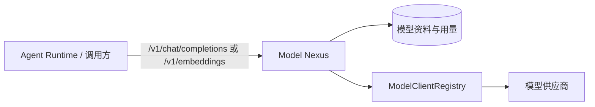

<p align="center">
  
</p>

# g2rain-model-nexus

> 下一代AI软件开发范式，AI原生Agent平台，开源的企业级SaaS底座。

谷雨 Agent 平台的模型访问网关。它统一管理模型服务目录、接入资料与用量记录，并将 OpenAI 风格的聊天和 Embeddings 请求路由至不同模型供应商。

[官网](https://www.g2rain.com) · [Issues](https://github.com/g2rain/g2rain/issues) · [Discussions](https://github.com/g2rain/g2rain/discussions)

## 平台定位

Model Nexus 位于 Agent 平台的模型能力边界：Agent Runtime 或其他调用方经由标准 `/v1` 接口使用模型；本服务根据模型资料选择 OpenAI、Anthropic 或 Google GenAI 客户端，并屏蔽供应商差异。它不负责任务编排、MCP 工具注册或 Agent/Skill 配置管理。

## 功能概览

| 能力 | 说明 |
| --- | --- |
| OpenAI 兼容网关 | 提供聊天补全与文本向量化接口；`/v1/**` 使用 OpenAI 风格错误响应。 |
| 多协议路由 | 通过 `ModelClientRegistry` 按模型接入资料选择 OpenAI、Anthropic 或 Google GenAI 客户端。 |
| 请求与响应转换 | 在 OpenAI 模型和 Spring AI 模型之间转换消息、工具调用、Embeddings 与用量。 |
| 模型资料与用量 | 管理模型服务目录、服务接入资料及模型用量记录。 |

## 核心流程



1. 调用方提交 OpenAI 风格的聊天或 Embeddings 请求，并指定模型。
2. 服务定位启用的模型接入资料，按协议选择模型客户端。
3. 请求经转换后调用供应商；响应、工具调用和用量再映射为 OpenAI 风格模型。
4. `/v1/**` 路径的协议异常通过专用过滤器与异常映射输出兼容错误体。

## 工程结构

| 模块 | 说明 |
| --- | --- |
| `g2rain-model-nexus-api` | 定义 OpenAI 兼容请求/响应、错误模型及模型管理契约。 |
| `g2rain-model-nexus-biz` | 实现模型资料、协议路由、请求转换、用量与 Web 接口。 |
| `g2rain-model-nexus-startup` | 组装 Spring Boot、协议错误过滤和异常映射。 |

模块依赖方向固定为：`startup → biz → api`。

## 本地启动

前置条件：JDK 25、Maven，以及可用的 MySQL、Redis 和已配置的模型服务。默认 profile 为 `nacos`；进行本地联调时可选用 `dev`，并在本机安全地设置数据源和模型供应商凭据。

```powershell
mvn -pl g2rain-model-nexus-startup -am spring-boot:run "-Dspring-boot.run.profiles=dev"
```

服务端口由 `SERVER_PORT` 环境变量控制，未设置时使用 `8080`。`/v1/**` 请求使用 OpenAI 风格错误响应；请由 Nacos 或安全的环境变量供应生产配置，勿提交密钥。

## 接口说明

| 接口 | 用途 |
| --- | --- |
| `POST /v1/chat/completions` | 按请求的 `model` 路由启用的聊天模型，并返回 OpenAI 风格补全结果。 |
| `POST /v1/embeddings` | 按请求的 `model` 路由启用的向量模型，并返回 OpenAI 风格 Embeddings 结果。 |
| `/model_service_catalog` | 查询、保存和删除模型服务目录。 |
| `/model_service_profile` | 查询、保存和删除模型接入资料。 |
| `/model_usage_record` | 查询、保存和删除模型用量记录。 |

实际可用模型由模型目录和接入资料决定；调用前应先完成模型登记、授权与连通性验证。

## 配置与安全

| 配置项 | 说明 |
| --- | --- |
| `SERVER_PORT` | HTTP 端口，默认 `8080`。 |
| `SPRING_PROFILES_ACTIVE` | 默认 `nacos`；本地可显式使用 `dev`。 |
| `NACOS_SERVER_ADDR` | Nacos 注册与配置中心地址。 |
| `g2rain.model-nexus.protocol-error-path-patterns` | 使用 OpenAI 协议错误映射的路径，当前含 `/v1/**`。 |

供应商 API Key、Token、私有端点、请求内容和用量资料均为敏感信息：只通过 Secret 或受控配置提供，并在日志、错误响应和文档中脱敏。模型目录、用量和模型管理操作需要可信租户上下文、授权与审计。

## 构建与验证

| 目标 | 命令 | 说明 |
| --- | --- | --- |
| 构建与验证 | `mvn clean verify` | 执行 Maven 验证生命周期。 |
| 启动服务 | `mvn -pl g2rain-model-nexus-startup -am spring-boot:run -Dspring-boot.run.profiles=dev` | 本地联调使用独立开发环境。 |
| 构建本地镜像 | `./build.sh <tag>` | 使用 Jib 构建 `g2rain/g2rain-model-nexus:<tag>`。 |

## 协作关系

- **Agent Runtime** 经由 Model Nexus 获取聊天、工具调用和向量能力。
- **Agent Studio** 可在 Agent 配置中引用已登记的模型服务。
- **MCP Registry** 提供工具能力，与本模块的模型能力形成互补。

## 排障提示

- `/v1` 调用失败时，检查模型名称、启用状态、协议客户端、供应商授权及 OpenAI 错误映射。
- Embeddings 异常时，检查模型类型、输入格式、维度参数和供应商能力。
- 服务无法启动时，优先检查 profile、Nacos、MySQL、Redis 和模型资料配置。

## 文档与贡献

- [项目文档索引](docs/index.md)
- [架构总览](docs/architecture/overview.md)
- [本地开发](docs/development/local-development.md)
- [安全边界](docs/security/security-boundaries.md)

欢迎通过 Issue、文档改进、功能建议和 Pull Request 参与贡献。提交前请补充必要的测试和文档，执行 `mvn clean verify`，并同步 API、协议、配置、安全与架构说明。
