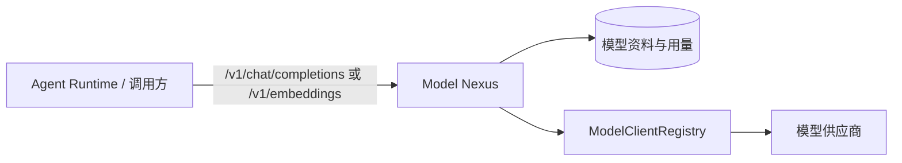

<p align="center">
  
</p>

# g2rain-model-nexus

[](LICENSE)
[](https://openjdk.org/)
[](https://spring.io/projects/spring-boot)
[](https://spring.io/projects/spring-cloud)
[](https://maven.apache.org/)

G2rain（谷雨）是面向企业的开源智能体平台，连接模型、知识与业务工具，让智能体在明确的身份和权限边界内执行任务。当前平台已具备应用开发与部署能力；智能体平台与智能客服已开发完成并开源，交易开通、计量计费等商业化能力仍处于规划设计中。`g2rain-model-nexus` 是其中的模型访问服务，统一管理模型服务目录、接入资料与用量记录，并将 OpenAI 风格的聊天和 Embeddings 请求路由至不同模型供应商；它不代表或替代整个平台能力。

[官网](https://www.g2rain.com) · [完整文档](docs/index.md) · [中央架构 Profile](https://github.com/g2rain/g2rain/tree/architecture-v1.0.0/docs/architecture/profiles/java-domain-service) · [架构说明](docs/architecture/overview.md) · [代码规范](docs/development/code-conventions.md) · [Issues](https://github.com/g2rain/g2rain/issues) · [Discussions](https://github.com/g2rain/g2rain/discussions)

## 项目定位

`g2rain-model-nexus` 位于平台模型能力边界：Agent Runtime 或其他调用方经由标准 `/v1` 接口使用模型；本服务根据模型资料选择 OpenAI、Anthropic 或 Google GenAI 客户端，并屏蔽供应商差异。它不负责任务编排、MCP 工具注册、Agent/Skill 配置管理、网关鉴权或部署编排。

## 功能概览

| 能力 | 说明 |
| --- | --- |
| OpenAI 兼容网关 | 提供聊天补全与文本向量化接口；`/v1/**` 使用 OpenAI 风格错误响应。 |
| 多协议路由 | 通过 `ModelClientRegistry` 按模型接入资料选择 OpenAI、Anthropic 或 Google GenAI 客户端。 |
| 请求与响应转换 | 在 OpenAI 模型和 Spring AI 模型之间转换消息、工具调用、Embeddings 与用量。 |
| 模型资料与用量 | 管理模型服务目录、服务接入资料及模型用量记录。 |

## 核心流程



1. 调用方提交 OpenAI 风格的聊天或 Embeddings 请求，并指定模型。
2. 服务定位启用的模型接入资料，按协议选择模型客户端。
3. 请求经转换后调用供应商；响应、工具调用和用量再映射为 OpenAI 风格模型。
4. `/v1/**` 路径的协议异常通过专用过滤器与异常映射输出兼容错误体。

## 工程结构

| 模块 | 说明 |
| --- | --- |
| `g2rain-model-nexus-api` | 定义 OpenAI 兼容请求/响应、错误模型及模型管理契约。 |
| `g2rain-model-nexus-biz` | 实现模型资料、协议路由、请求转换、用量与 Web 接口。 |
| `g2rain-model-nexus-startup` | 组装 Spring Boot、协议错误过滤和异常映射。 |

模块依赖方向固定为：`startup → biz → api`。

## 技术栈

| 类别 | 技术 |
| --- | --- |
| 运行时 | Java 25、Spring Boot 4.1.2、Spring Cloud 2025.1.4、Spring AI 2.0.2 |
| 数据访问 | MyBatis、MySQL、MapStruct |
| 平台基础设施 | Redis、Nacos、模型供应商服务 |
| API 与文档 | Spring Web、Jakarta Validation、OpenAPI |
| 构建与部署 | Maven、Jib、Docker |
| 测试 | Spring Boot Test / JUnit 5（当前构建在编译阶段失败，详见测试文档） |

## 快速开始

前置条件：JDK 25、Maven，以及可用的 MySQL、Redis 和已配置的模型服务。默认 profile 为 `nacos`；进行本地联调时可选用 `dev`，并在本机安全地设置数据源和模型供应商凭据。

### 构建与测试

```bash
mvn clean verify
```

当前验证结果见[测试策略](docs/development/testing.md)；该命令失败不代表容器已构建、发布或部署。

### 启动服务

```powershell
mvn -pl g2rain-model-nexus-startup -am spring-boot:run "-Dspring-boot.run.profiles=dev"
```

服务端口由 `SERVER_PORT` 环境变量控制，未设置时使用 `8080`。`/v1/**` 请求使用 OpenAI 风格错误响应；请由 Nacos 或安全的环境变量供应生产配置，勿提交密钥。健康检查入口为 `GET /actuator/health`。

## 接口说明

| 接口 | 用途 |
| --- | --- |
| `POST /v1/chat/completions` | 按请求的 `model` 路由启用的聊天模型，并返回 OpenAI 风格补全结果。 |
| `POST /v1/embeddings` | 按请求的 `model` 路由启用的向量模型，并返回 OpenAI 风格 Embeddings 结果。 |
| `/model_service_catalog` | 查询、保存和删除模型服务目录。 |
| `/model_service_profile` | 查询、保存和删除模型接入资料。 |
| `/model_usage_record` | 查询、保存和删除模型用量记录。 |

实际可用模型由模型目录和接入资料决定；调用前应先完成模型登记、授权与连通性验证。

## 配置与安全

| 配置项 | 说明 |
| --- | --- |
| `SERVER_PORT` | HTTP 端口，默认 `8080`。 |
| `SPRING_PROFILES_ACTIVE` | 默认 `nacos`；本地可显式使用 `dev`。 |
| `NACOS_SERVER_ADDR` | Nacos 注册与配置中心地址。 |
| `g2rain.model-nexus.protocol-error-path-patterns` | 使用 OpenAI 协议错误映射的路径，当前含 `/v1/**`。 |

供应商 API Key、Token、私有端点、请求内容和用量资料均为敏感信息：只通过 Secret 或受控配置提供，并在日志、错误响应和文档中脱敏。模型目录、用量和模型管理操作需要可信租户上下文、授权与审计。

## 构建与验证

| 目标 | 命令 | 说明 |
| --- | --- | --- |
| 构建与验证 | `mvn clean verify` | 执行 Maven 验证生命周期。 |
| 启动服务 | `mvn -pl g2rain-model-nexus-startup -am spring-boot:run -Dspring-boot.run.profiles=dev` | 本地联调使用独立开发环境。 |
| 构建本地镜像 | `./build.sh 1.0.0` | 先执行完整 Maven 构建与测试，再用 Jib 构建并载入本地 Docker；需要 Docker daemon。 |

## GHCR 镜像

- 镜像：`ghcr.io/g2rain/g2rain-model-nexus`
- 稳定版 tag 为 Maven 版本，例如 `1.0.0`；同一次发布同时推送不可变的 `sha-<完整 Git 提交 SHA>`。不推送 `latest`。
- 拉取示例：`docker pull ghcr.io/g2rain/g2rain-model-nexus:1.0.0`
- 仅当已进入 `main` 的提交被推送为精确 `v<major>.<minor>.<patch>` Git tag、同名发布说明存在且 Maven 版本匹配时，GitHub Actions 才会构建、测试并推送。普通分支、Pull Request 和手动触发不会发布。

完整的权限、构建、推送、镜像内容、公开包设置和部署前检查见[构建与部署](docs/operations/deployment.md)。镜像发布不代表平台在线演示可用，也不代表已在目标环境完成部署验证。

## 协作关系

- **Agent Runtime** 经由 Model Nexus 获取聊天、工具调用和向量能力。
- **Agent Studio** 可在 Agent 配置中引用已登记的模型服务。
- **MCP Registry** 提供工具能力，与本模块的模型能力形成互补。

## 排障提示

- `/v1` 调用失败时，检查模型名称、启用状态、协议客户端、供应商授权及 OpenAI 错误映射。
- Embeddings 异常时，检查模型类型、输入格式、维度参数和供应商能力。
- 服务无法启动时，优先检查 profile、Nacos、MySQL、Redis 和模型资料配置。

## 项目文档

| 场景 | 入口 |
| --- | --- |
| 文档首页 | [docs/index.md](docs/index.md) |
| 架构与模块 | [架构总览](docs/architecture/overview.md) · [模块与依赖](docs/architecture/modules.md) |
| 本地开发与测试 | [本地开发](docs/development/local-development.md) · [测试策略](docs/development/testing.md) |
| 配置、安全与部署 | [配置说明](docs/operations/configuration.md) · [安全边界](docs/security/security-boundaries.md) · [构建与部署](docs/operations/deployment.md) |
| 发布记录 | [v1.0.0](docs/releases/v1.0.0.md) |
| 故障排查 | [docs/operations/troubleshooting.md](docs/operations/troubleshooting.md) |

## 贡献

欢迎通过 Issue、文档改进、功能建议和 Pull Request 参与贡献。提交前请补充必要的测试和文档，执行 `mvn clean verify`，并同步 API、协议、配置、安全与架构说明。

## 许可证

本项目基于 [Apache 2.0 许可证](LICENSE) 开源。
